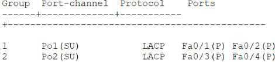
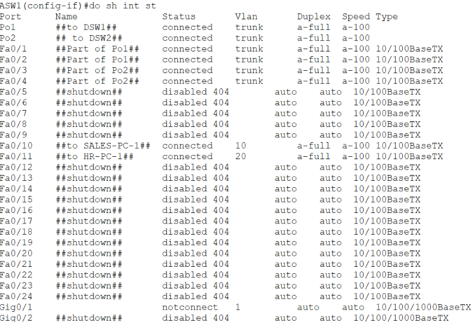
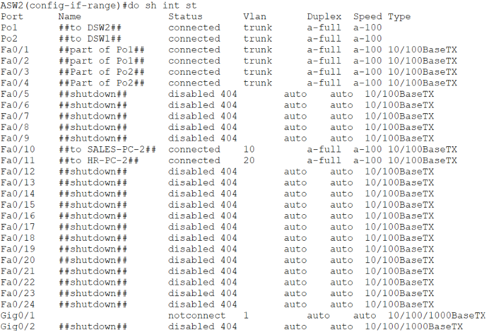
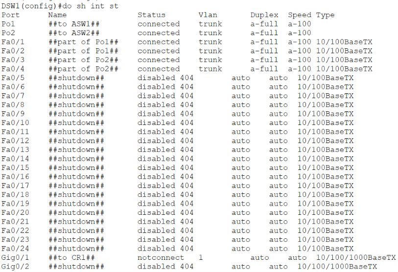
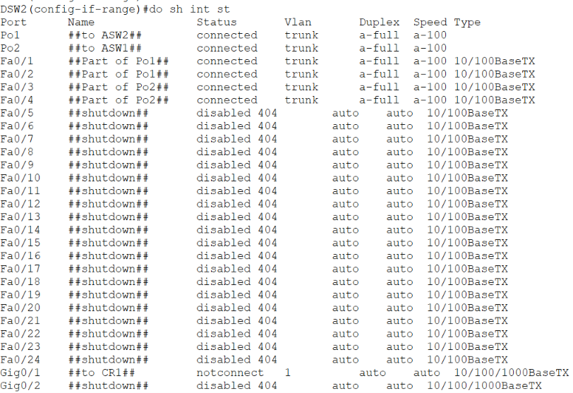
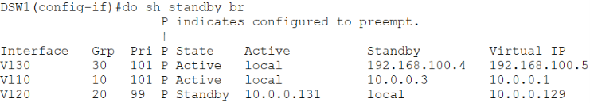
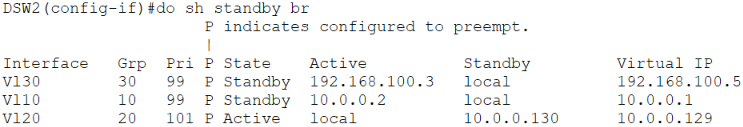

# CCNA Lab 3

>[!NOTE]
>This Project was scrapped as It got overly complicated as i could no achieve my goals of managing the all the devices from a single devices 
>Probably the issue may be one/many/all of the causes 
>1. Due to the native VLAN configuration made 
>2. SVI misconfigurations 
>3. OSPF routes misconfigurations 


# Network Topology 


## Devices 

| DEVICES    | NAME                  |
| ---------- | --------------------- |
| DSW1       | Distribution Switch 1 |
| DSW2       | Distribution Switch 2 |
| ASW1       | Access Switch 1       |
| ASW2       | Access Switch 2       |
| SALES-PC-1 | Sales Department PC   |
| SALES-PC-2 | Sales Department PC   |
| HR-PC-1    | HR Department PC      |
| HR-PC-2    | HR Department PC      |

---
## Layer 2 Configurations 

### Port-channel configurations 

| Device | Channel - Bundle | protocol/op-mode | Port channel interface |
| ------ | ---------------- | ---------------- | ---------------------- |
| ASW1   | F0/1, F0/2       | LACP passive     | Po1                    |
| ASW2   | F0/1, F0/2       | LACP passive     | Po1                    |
| DSW1   | F0/1, F0/2       | LACP active      | Po1                    |
| DSW2   | F0/1, F0/2       | LACP active      | Po1                    |
| ASW1   | F0/3, F0/4       | LACP passive     | Po2                    |
| ASW2   | F0/3, F0/4       | LACP passive     | Po2                    |
| DSW1   | F0/3, F0/4       | LACP active      | Po2                    |
| DSW2   | F0/3, F0/4       | LACP active      | Po2                    |

>[!NOTE]
>Configuring the Port-Channel mode on the **Source and Destination IP** 

##### Configuration Images 
###### ASW1 ASW2 DSW1 DSW2


---
### VLAN configurations 
Configuring the following VLANS on the devices mentioned below 

```
VLAN 10 - SALES
VLAN 20 - HR
VLAN 30 - MANAGEMENT 
VLAN 99 - NATIVE
VLAN 404 - DISABLED
```

#### Device Assignment 

| Devices    | VLAN assigned |
| ---------- | ------------- |
| SALES-PC-1 | 10            |
| HR-PC-1    | 20            |
| SALES-PC-2 | 10            |
| HR-PC-2    | 20            |

#### Trunk configurations 
The following configurations are performed on the trunk ports of ASW1 , ASW2 , DSW1 and DSW2 

>[!NOTE]
>Following Interfaces have been configured on the Above devices 
>- Po1
>- Po2

- **Native VLAN : 99**
- **Allowed VLAN : `[10,20,30,99]`**

---
### Interface status 
#### ASW1


#### ASW2


#### DSW1


#### DSW2


---
### Spanning Tree Configurations

The spanning tree protocol that is being used is the default spanning tree protocol **802.1D in PVST+ mode*

| Device | VLAN | Bridge Priority   |
| ------ | ---- | ----------------- |
| DSW1   | 10   | 24586 (Primary)   |
| DSW1   | 20   | 28692 (Secondary) |
| DSW1   | 30   | 24606 (Primary)   |
| DSW1   | 99   | 24675 (Primary)   |
| DSW1   | 404  | 24980 (Primary)   |
| DSW2   | 10   | 28682 (Secondary) |
| DSW2   | 20   | 24596 (Primary)   |
| DSW2   | 30   | 28702 (Secondary) |
| DSW2   | 99   | 28771 (Secondary) |
| DSW2   | 404  | 29706 (Primary )  |
>[!NOTE]
>For the VLAN 404 There is no proper spanning tree root as the trunk interfaces do not carry traffic for VLAN 404 
## Layer 3 Configurations 

### Management IP configurations on the devices 

| Device name | IP address    | Subnet        | Default Gateway (If Applicable) |
| ----------- | ------------- | ------------- | ------------------------------- |
| ASW1        | 192.168.100.1 | 255.255.255.0 | 192.168.100.5                   |
| ASW2        | 192.168.100.2 | 255.255.255.0 | 192.168.100.5                   |
| DSW1        | 192.168.100.3 | 255.255.255.0 | N/A                             |
| DSW2        | 192.168.100.4 | 255.255.255.0 | N/A                             |

---

### SVI configurations for the separate VLAN's in area 1

| Device name | IP address | subnet mask     | Interface name |
| ----------- | ---------- | --------------- | -------------- |
| DSW1        | 10.0.0.2   | 255.255.255.128 | vlan 10        |
| DSW1        | 10.0.0.130 | 255.255.255.128 | vlan 20        |
| DSW2        | 10.0.0.3   | 255.255.255.128 | vlan 10        |
| DSW2        | 10.0.0.131 | 255.255.255.128 | vlan 20        |

---

### Back Bone Area configurations 

| Device name | IP address | subnet mask     | Interface name |
| ----------- | ---------- | --------------- | -------------- |
| CR1         | 172.16.0.1 | 255.255.255.252 | G0/0           |
| DSW1        | 172.16.0.2 | 255.255.255.252 | G0/1           |
| CR1         | 172.16.0.5 | 255.255.255.252 | G0/1           |
| DSW2        | 172.16.0.6 | 255.255.255.252 | G0/1           |

>[!NOTE]
>The **G0/1 interfaces** of **DSW1 and DSW2** has been configured with the following command 
>```CISCO CLI
>no switchport
>```


---
### HSRP configuration
All of the HSRP configuration have been configured with 
- version 2
- preemption
- Priority=101 for the Active routers 
- Priority=99 for the standby routers

#### Management HSRP 
This is configured with the group number 30
- VIP : **192.168.100.5** 
- DSW1: Active Router 
- DSW2 : Standby Router 

#### Sales HSRP 
This is configured with the group number 10
- VIP : **10.0.0.1**
- DSW1: Active Router 
- DSW2 : Standby Router 

#### HR HSRP 
This is configured with the group number 10
- VIP : **10.0.0.129**
- DSW2: Active Router 
- DSW1 : Standby Router 

##### HSRP status
###### DSW1

###### DSW2


---

### OSPF Configurations

#### Area 0 Configuration 


