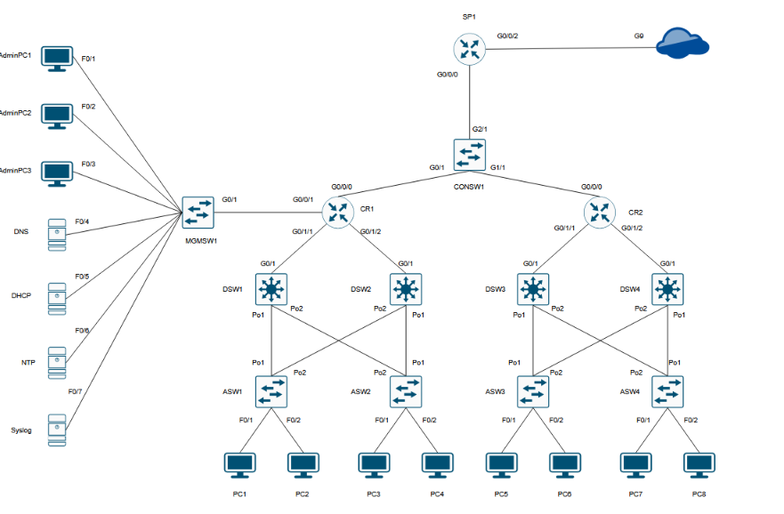

# CCNA Lab 3

>[!NOTE]
>This lab was built in pursuit of my CCNA Certification Learning and Tries to mimic the real world scenarios as closely as possible 

## Scenario 

- Basic Setup for a SOHO environment for an Enterprise A with several network functions which includes 
	- routing 
	- FTP 
	- DNS
	- DHCP 
	- NTP 

>[!note]
>This based on best of my knowledge

---
## Lab Topology 

---

## Layer 2 configurations 

### VLAN configurations 

On the following switches i.e. `ASW1 ASW2 ASW3 ASW4` `DSW1 DSW2 DSW3 DSW4` `MGMSW1 CONSW1` the following VLAN's will be created 
- VLAN 99 : Management VLAN 
- VLAN 100 : Sales 
- VLAN 200 : Logistics 
- VLAN 404 : Disabled 

### Configuring Access ports in the proper VLAN 

| PC names           | VLAN |
| ------------------ | ---- |
| PC1, PC3, PC5, PC7 | 100  |
| PC2, PC4, PC6, PC8 | 200  |

>[!NOTE]
>For safety I have moved all of the unused ports in VLAN 404 and have disabled it 

