# CCNA Lab 3

>[!NOTE]
>This Project was scrapped as It got overly complicated as i could no achieve my goals of managing the all the devices from a single devices 
>Probably the issue may be one/many/all of the causes 
>1. Due to the native VLAN configuration made 
>2. SVI misconfigurations 
>3. OSPF routes misconfigurations 


# Network Topology 


## Devices 

| DEVICES    | NAME                                   |
| ---------- | -------------------------------------- |
| DSW1       | Distribution Switch 1                  |
| DSW2       | Distribution Switch 2                  |
| DSW3       | Distribution Switch 3                  |
| DSW4       | Distribution Switch 4                  |
| ASW1       | Access Switch 1                        |
| ASW2       | Access Switch 2                        |
| ASW3       | Access Switch 3                        |
| ASW4       | Access Switch 4                        |
| SALES-PC-1 | Sales Department PC                    |
| SALES-PC-2 | Sales Department PC                    |
| HR-PC-1    | HR Department PC                       |
| HR-PC-2    | HR Department PC                       |
| DEV-PC-1   | Development Department PC              |
| DEV-PC-2   | Development Department PC              |
| QA-PC-1    | Quality Assurance Department PC        |
| QA-PC-2    | Quality Assurance Department PC        |
| CS-1       | Core Switch 1                          |
| CONSW1     | Connection Switch 1                    |
| ADMIN-PC-1 | Administrator PC                       |
| ADMIN-PC-2 | Administrator PC                       |
| DHCP       | Dynamic Host Configuration Protocol    |
| NTP        | Network Time Protocol                  |
| SYSLOG     | Logging information                    |
| SNMP-NMS-1 | Simple Network Management Protocol NMS |
| FTP/TFP    | `[Trivial]`File transfer Protocol      |
| DNS        | Domain Name System                     |
| ISP        | ISP Router                             |
| CER        | Customer Edge Router                   |


---
## Layer 2 Configurations 

### Port-channel configurations 

| Device | Channel - Bundle | protocol/op-mode | Port channel interface |
| ------ | ---------------- | ---------------- | ---------------------- |
| ASW1   | F0/1, F0/2       | LACP passive     | Po1                    |
| ASW2   | F0/1, F0/2       | LACP passive     | Po1                    |
| DSW1   | F0/1, F0/2       | LACP active      | Po1                    |
| DSW2   | F0/1, F0/2       | LACP active      | Po1                    |
| ASW1   | F0/3, F0/4       | LACP passive     | Po2                    |
| ASW2   | F0/3, F0/4       | LACP passive     | Po2                    |
| DSW1   | F0/3, F0/4       | LACP active      | Po2                    |
| DSW2   | F0/3, F0/4       | LACP active      | Po2                    |
| ASW3   | F0/1, F0/2       | LACP passive     | Po1                    |
| ASW4   | F0/1, F0/2       | LACP passive     | Po1                    |
| DSW3   | F0/1, F0/2       | LACP active      | Po1                    |
| DSW4   | F0/1, F0/2       | LACP active      | Po1                    |
| ASW3   | F0/3, F0/4       | LACP passive     | Po2                    |
| ASW4   | F0/3, F0/4       | LACP passive     | Po2                    |
| DSW3   | F0/3, F0/4       | LACP active      | Po2                    |
| DSW4   | F0/3, F0/4       | LACP active      | Po2                    |

>[!NOTE]
>Configuring the Port-Channel mode on the **Source and Destination IP** 

##### Configuration Images 
###### ASW1 ASW2 ASW3 ASW4 DSW1 DSW2 DSW3 DSW4
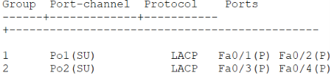

---
### VLAN configurations 
Configuring the following VLANS on devices on Floor A

```
VLAN 10 - SALES
VLAN 20 - HR
VLAN 30 - MANAGEMENT 
VLAN 99 - NATIVE
VLAN 404 - DISABLED
```

Configuring the following VLANS on devices on Floor B

```
VLAN 40 - DEVELOPMENT
VLAN 50 - QA
VLAN 30 - MANAGEMENT 
VLAN 99 - NATIVE
VLAN 404 - DISABLED
```

#### Device Assignment for **Floor A**

| Devices    | VLAN assigned |
| ---------- | ------------- |
| SALES-PC-1 | 10            |
| HR-PC-1    | 20            |
| SALES-PC-2 | 10            |
| HR-PC-2    | 20            |

#### Device Assignment for **Floor B**

| Devices  | VLAN assigned |
| -------- | ------------- |
| DEV-PC-1 | 40            |
| DEV-PC-2 | 40            |
| QA-PC-1  | 50            |
| QA-PC-2  | 50            |


#### Trunk configurations 
The following configurations are performed on the trunk ports of **ASW1 , ASW2 , DSW1 and DSW2** 

>[!NOTE]
>Following Interfaces have been configured on the Above devices 
>- Po1
>- Po2

- **Native VLAN : 99**
- **Allowed VLAN : `[10,20,30,99]`**

The following configurations are performed on the trunk ports of **ASW3 , ASW4 , DSW3 and DSW4** 

>[!NOTE]
>Following Interfaces have been configured on the Above devices 
>- Po1
>- Po2

- **Native VLAN : 99**
- **Allowed VLAN : `[40,50,30,99]`**

>**Moving all of the unused interfaces in the VLAN 404 with the shutdown command initiated**


##### Trunk Configuration Images 

###### ASW1 and ASW2
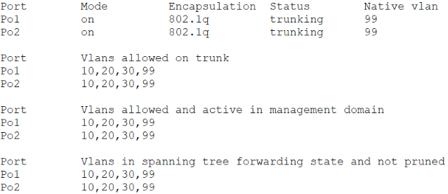

###### DSW1
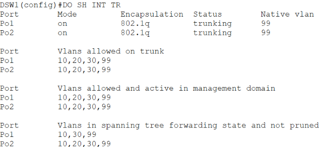

###### DSW2
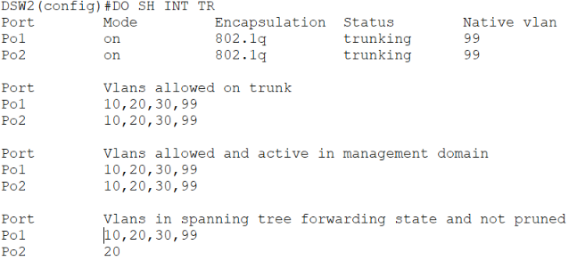

###### ASW3 AND ASW4
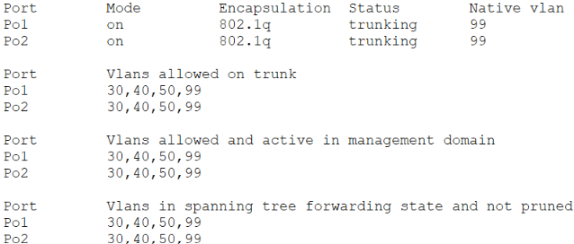

###### DSW3
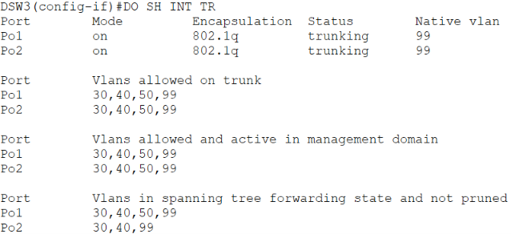
###### DSW4
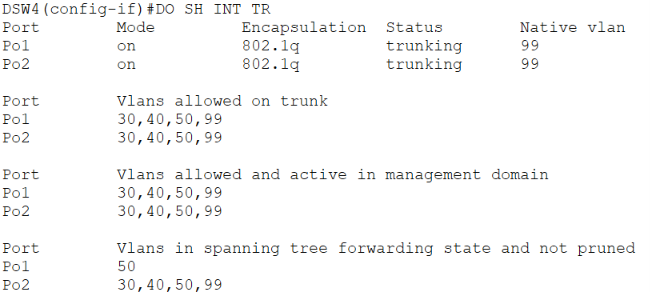

---
### Interface status 
#### ASW1
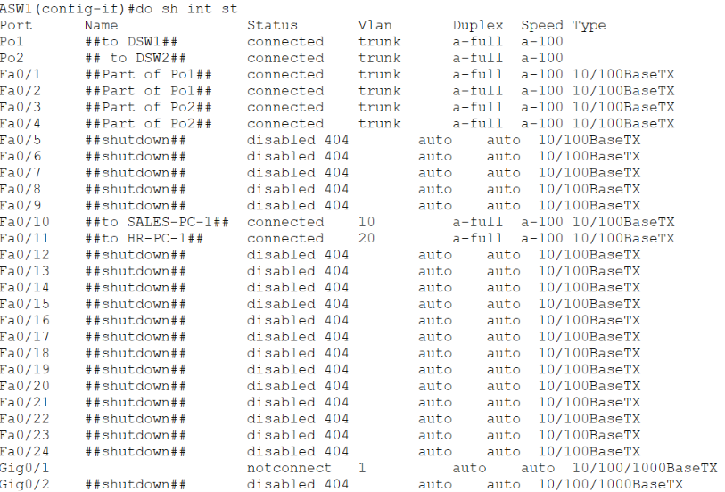

#### ASW2
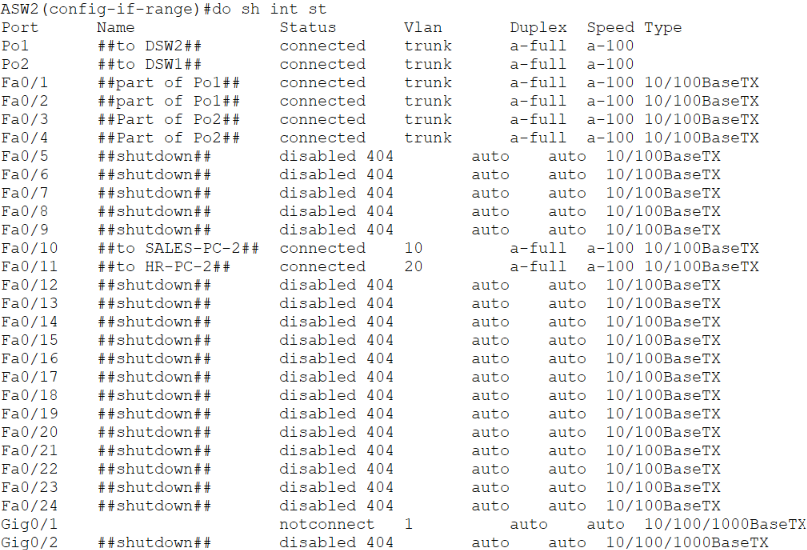

#### DSW1
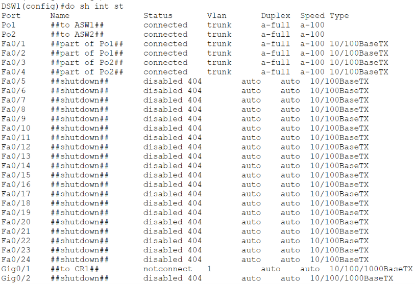

#### DSW2
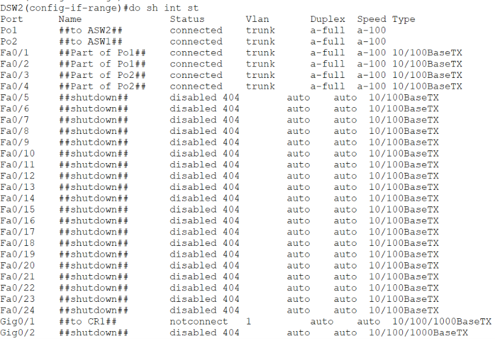

#### ASW3
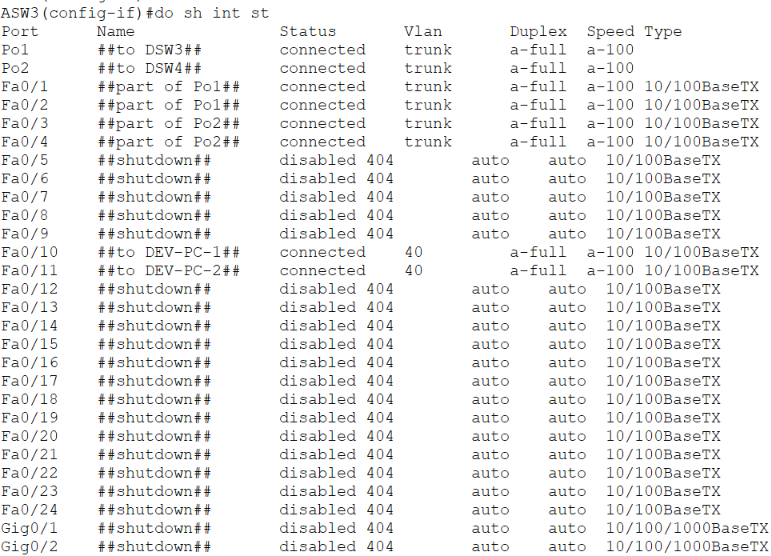

#### ASW4
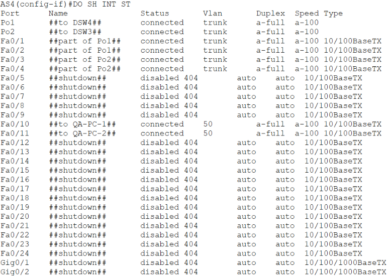

#### DSW3
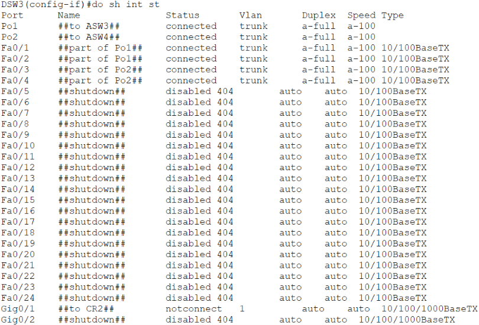

#### DSW4
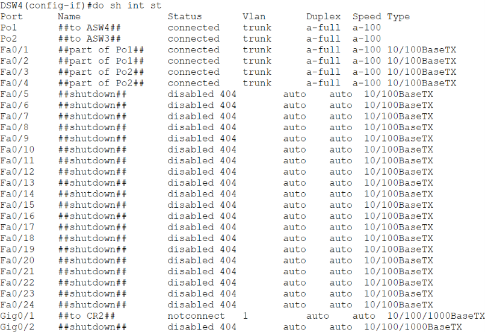

---
### Spanning Tree Configurations

The spanning tree protocol that is being used is the default spanning tree protocol **802.1D in PVST+ mode*

#### Floor A

| Device | VLAN | Bridge Priority   |
| ------ | ---- | ----------------- |
| DSW1   | 10   | 24586 (Primary)   |
| DSW1   | 20   | 28692 (Secondary) |
| DSW1   | 30   | 24606 (Primary)   |
| DSW1   | 99   | 24675 (Primary)   |
| DSW1   | 404  | 24980 (Primary)   |
| DSW2   | 10   | 28682 (Secondary) |
| DSW2   | 20   | 24596 (Primary)   |
| DSW2   | 30   | 28702 (Secondary) |
| DSW2   | 99   | 28771 (Secondary) |
| DSW2   | 404  | 29706 (Primary )  |
#### Floor B 

| Device | VLAN | Bridge Priority   |
| ------ | ---- | ----------------- |
| DSW3   | 40   | 24616 (Primary)   |
| DSW3   | 50   | 28722 (Secondary) |
| DSW3   | 30   | 24606 (Primary)   |
| DSW3   | 99   | 24675 (Primary)   |
| DSW3   | 404  | 24980 (Primary)   |
| DSW4   | 40   | 28712 (Secondary) |
| DSW4   | 50   | 24626 (Primary)   |
| DSW4   | 30   | 28702 (Secondary) |
| DSW4   | 99   | 28771 (Secondary) |
| DSW4   | 404  | 24980 (Primary )  |

>[!NOTE]
>For the VLAN 404 There is no proper spanning tree root as the trunk interfaces do not carry traffic for VLAN 404 

>[!NOTE]
>command 
>```
>(config-if) # spanning-tree portfast
>(config-if) # spanning-tree bpduguard enable
>(config-if) # spanning-tree bpdufilter enable
>```
>The following command has been configured has configured on the interfaces **F0/10 and F0/11** on all of the following devices 
>- ASW1
>- ASW2
>- ASW3
>- ASW4


---
## Layer 3 Configurations 

###  IP configuration management of all devices on Floor A

| Device name | IP address    | Subnet        | Default Gateway (If Applicable) | Interface name |
| ----------- | ------------- | ------------- | ------------------------------- | -------------- |
| ASW1        | 192.168.100.1 | 255.255.255.0 | 192.168.100.5                   | VLAN 30        |
| ASW2        | 192.168.100.2 | 255.255.255.0 | 192.168.100.5                   | VLAN 30        |
| DSW1        | 192.168.100.3 | 255.255.255.0 | N/A                             | VLAN 30        |
| DSW2        | 192.168.100.4 | 255.255.255.0 | N/A                             | VLAN 30        |

###  IP configuration management of all devices on Floor B

| Device name | IP address    | Subnet        | Default Gateway (If Applicable) | Interface name |
| ----------- | ------------- | ------------- | ------------------------------- | -------------- |
| ASW3        | 192.168.200.1 | 255.255.255.0 | 192.168.200.5                   | VLAN 30        |
| ASW4        | 192.168.200.2 | 255.255.255.0 | 192.168.200.5                   | VLAN 30        |
| DSW3        | 192.168.200.3 | 255.255.255.0 | N/A                             | VLAN 30        |
| DSW4        | 192.168.200.4 | 255.255.255.0 | N/A                             | VLAN 30        |

### IP configuration Management for devices in Area 1 

| Device name | IP address  | Subnet        | Default Gateway (If Applicable) | Interface name |
| ----------- | ----------- | ------------- | ------------------------------- | -------------- |
| CONSW1      | 192.168.0.1 | 255.255.255.0 | NA                              | VLAN 30        |
| ADMIN-PC-1  | 192.168.0.2 | 255.255.255.0 | 192.168.0.1                     | NIC            |
| ADMIN-PC-2  | 192.168.0.3 | 255.255.255.0 | 192.168.0.1                     | NIC            |
| DHCP        | 192.168.0.4 | 255.255.255.0 | 192.168.0.1                     | NIC            |
| NTP         | 192.168.0.5 | 255.255.255.0 | 192.168.0.1                     | NIC            |
| SYSLOG      | 192.168.0.6 | 255.255.255.0 | 192.168.0.1                     | NIC            |
| FTP/TFP     | 192.168.0.7 | 255.255.255.0 | 192.168.0.1                     | NIC            |
| DNS         | 192.168.0.8 | 255.255.255.0 | 192.168.0.1                     | NIC            |
### SVI configurations for the separate VLAN's in area 0 (Floor A)

| Device name | IP address | subnet mask     | Interface name |
| ----------- | ---------- | --------------- | -------------- |
| DSW1        | 10.0.0.2   | 255.255.255.128 | vlan 10        |
| DSW1        | 10.0.0.130 | 255.255.255.128 | vlan 20        |
| DSW2        | 10.0.0.3   | 255.255.255.128 | vlan 10        |
| DSW2        | 10.0.0.131 | 255.255.255.128 | vlan 20        |

### SVI configurations for the separate VLAN's in area 0 (Floor B)

| Device name | IP address | subnet mask     | Interface name |
| ----------- | ---------- | --------------- | -------------- |
| DSW3        | 10.1.0.2   | 255.255.255.128 | vlan 40        |
| DSW3        | 10.1.0.130 | 255.255.255.128 | vlan 50        |
| DSW4        | 10.1.0.3   | 255.255.255.128 | vlan 40        |
| DSW4        | 10.1.0.131 | 255.255.255.128 | vlan 50        |

### Floor A connections (CR1 DSW1 DSW2)

| Device name | IP address | subnet mask     | Interface name |
| ----------- | ---------- | --------------- | -------------- |
| CR1         | 172.16.0.1 | 255.255.255.252 | G0/0           |
| DSW1        | 172.16.0.2 | 255.255.255.252 | G0/1           |
| CR1         | 172.16.0.5 | 255.255.255.252 | G0/1           |
| DSW2        | 172.16.0.6 | 255.255.255.252 | G0/1           |

### Floor B connections (CR2 DSW3 DSW4)

| Device name | IP address | subnet mask     | Interface name |
| ----------- | ---------- | --------------- | -------------- |
| CR2         | 172.16.2.1 | 255.255.255.252 | G0/0           |
| DSW3        | 172.16.2.2 | 255.255.255.252 | G0/1           |
| CR2         | 172.16.2.5 | 255.255.255.252 | G0/1           |
| DSW4        | 172.16.2.6 | 255.255.255.252 | G0/1           |

### Central Switch connections  (CS1 CR1 CR2)
| Device name | IP address | subnet mask     | Interface name |
| ----------- | ---------- | --------------- | -------------- |
| CR1         | 172.16.1.2 | 255.255.255.252 | G0/1/0         |
| CR2         | 172.16.1.6 | 255.255.255.252 | G0/1/0         |
| CS1         | 172.16.1.1 | 255.255.255.252 | G1/1/1         |
| CS1         | 172.16.1.5 | 255.255.255.252 | G1/1/2         |

### Central Switch connection (CS1 CONSW1)

| Device name | IP address  | subnet mask     | Interface name |
| ----------- | ----------- | --------------- | -------------- |
| CS1         | 172.16.1.9  | 255.255.255.252 | G1/0/1         |
| CONSW1      | 172.16.1.10 | 255.255.255.252 | G0/1/0         |

### Area 0 Loopback configurations (CR1 CR2 CS1)

| Device name | IP address | subnet mask     | Interface name |
| ----------- | ---------- | --------------- | -------------- |
| CS1         | 8.8.8.8    | 255.255.255.255 | Loopback 0     |
| CR1         | 1.1.1.1    | 255.255.255.255 | Loopback 0     |
| CR2         | 6.6.6.6    | 255.255.255.255 | Loopback 0     |

### Area 0 IP configuration (ISP CS1)

| Device name | IP address  | subnet mask     | Interface name |
| ----------- | ----------- | --------------- | -------------- |
| CS1         | 172.16.1.13 | 255.255.255.252 | G1/1/3         |
| CER         | 172.16.1.14 | 255.255.255.252 | G0/1/0         |

### IP configuration (ISP CER)

| Device name | IP address  | subnet mask     | Interface name |
| ----------- | ----------- | --------------- | -------------- |
| ISP         | 203.0.113.1 | 255.255.255.252 | G0/0           |
| CER         | 203.0.113.2 | 255.255.255.252 | G0/0           |

>[!NOTE]
>- The **G0/1 interfaces** of **DSW1, DSW2, DSW3 and DSW4**
>- The **G1/1/1 , G1/1/2, G1/0/1 interfaces** of **CS1**
>- The **G1/0/1 interface** of **CONSW1** 
>
>have been configured with the following command
>```CISCO CLI
>no switchport
>```

---
### HSRP configuration
All of the HSRP configuration have been configured with 
- version 2
- preemption
- Priority=101 for the Active routers 
- Priority=99 for the standby routers

#### Floor A 
>[!NOTE]
>##### Management HSRP 
This is configured with the group number 30
>- VIP : **192.168.100.5** 
>- DSW1: Active Router 
>- DSW2 : Standby Router 
>
>##### Sales HSRP 
This is configured with the group number 10
>- VIP : **10.0.0.1**
>- DSW1: Active Router 
>- DSW2 : Standby Router 
>
>##### HR HSRP 
This is configured with the group number 10
>- VIP : **10.0.0.129**
>- DSW2: Active Router 
>- DSW1 : Standby Router 

#### Floor B 
>[!NOTE]
>##### Management HSRP 
This is configured with the group number 30
>- VIP : **192.168.200.5** 
>- DSW3: Active Router 
>- DSW4 : Standby Router 
>
>##### Development HSRP 
This is configured with the group number 40
>- VIP : **10.1.0.1**
>- DSW3: Active Router 
>- DSW4 : Standby Router 
>
>##### QA HSRP 
This is configured with the group number 50
>- VIP : **10.1.0.129**
>- DSW4: Active Router 
>- DSW3 : Standby Router 
##### HSRP status
###### DSW1
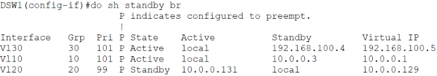
###### DSW2
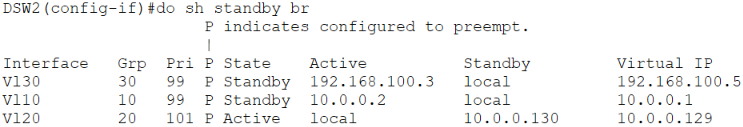

###### DSW3
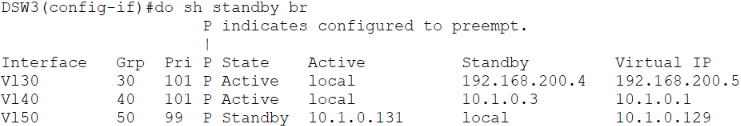

###### DSW4
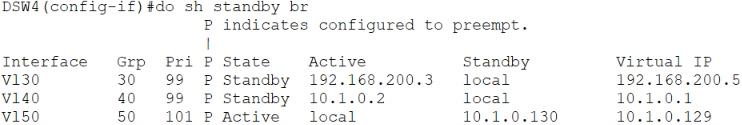

---

### OSPF Configuration on all devices 

#### DSW1
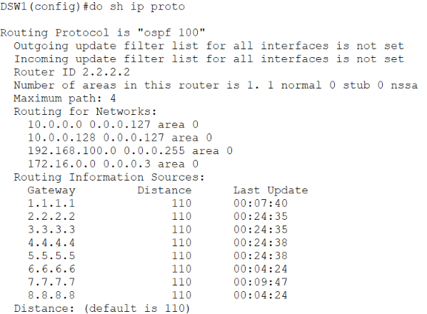

#### DSW2
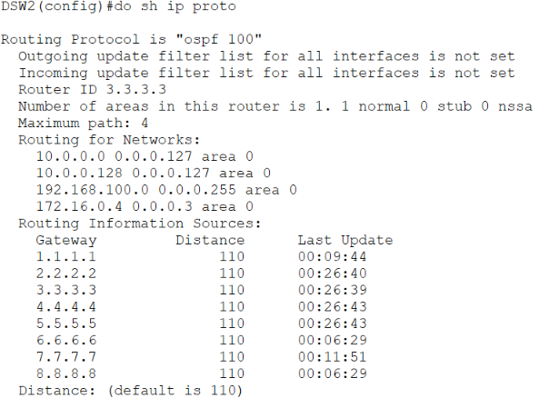

#### CR1 
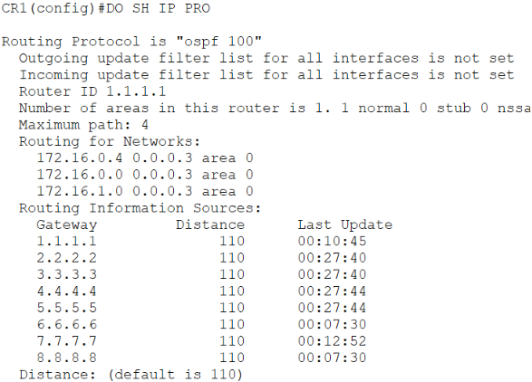

#### CS1 
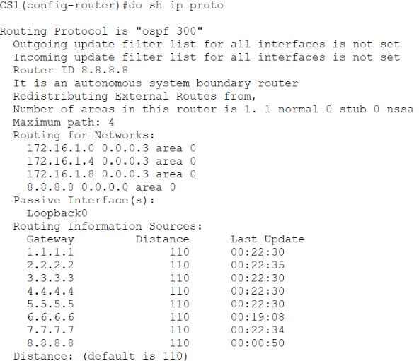


>[!NOTE]
>**CS1** has been configured with the following command given below 
>```
>(config-router) # default-information orginate
>```
#### CONSW1
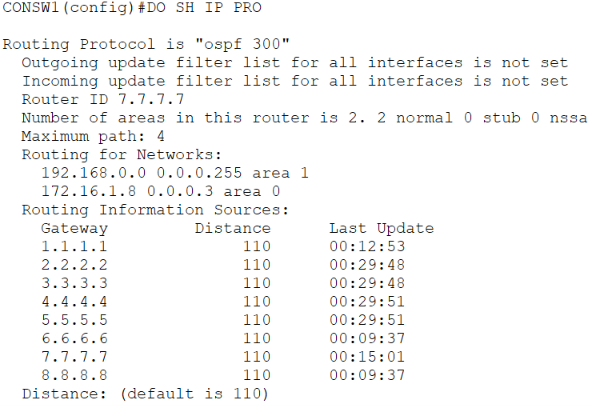

#### CR2
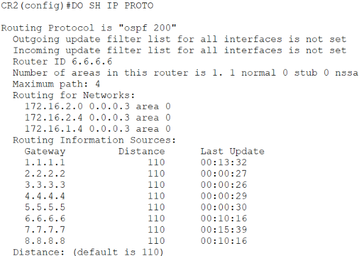

#### DSW3
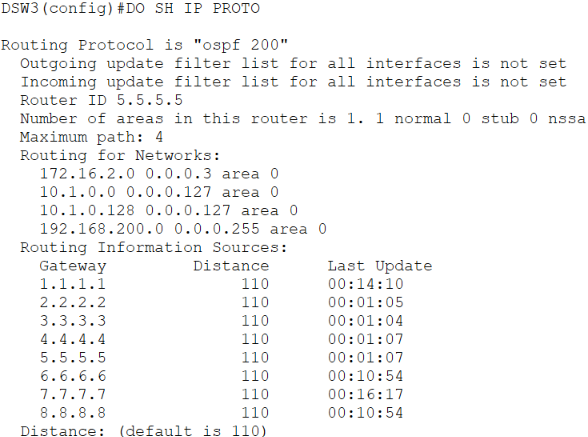

#### DSW4


---
## IP services

#### DHCP configuration 

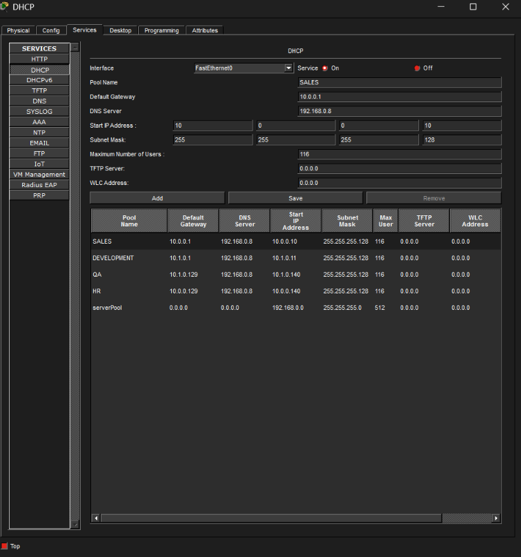

>[!note]
>```
>ip helper-address 192.168.0.4
>```
>The above command has been configured on the devices mentioned below 
> - DSW1 on interfaces : VLAN 10 , VLAN 20
> - DSW2 on interfaces : VLAN 10 , VLAN 20
> - DSW3 on interfaces : VLAN 40 , VLAN 50
> - DSW4 on interfaces : VLAN 40 , VLAN 50

---

### IP DNS service

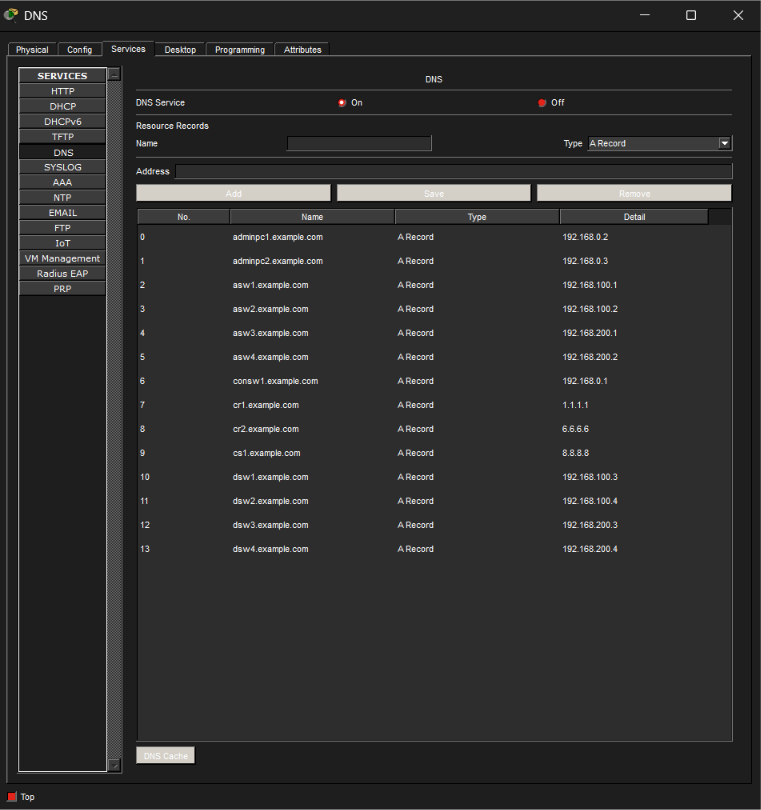

>[!NOTE]
>command 
>```
>(config)#ip domain-name example.com
>```
>- The above command has been configured on all networking devices 
>
>command
>```
>(config)#ip name-server 192.168.0.8
>(config)#ip domain-lookup 
>```
>- The above command has been configured on all of the networking devices except the ones given below 
>	- ASW1
>	- ASW2
>	- ASW3
>	- ASW4

---

### IP SSH configuration 

>[!note]
>commands
>```
>(config)#crypto key generate rsa general-keys modulus 768
>(config)#ip ssh version 2
>(config)#line vty 0 15
>(line-config)#transport input ssh 
>```
>
>The above commands has been issued on all of the networking interfaces 

---
### SNMP configurations 

>[!note]
>commands
>```
>(config)#snmp-server community cisco1 ro
>(config)#snmp-server community cisco2 rw
>```
>
>The above commands has been issued on all of the networking interfaces 

---

### Syslog configuration 

>[!note]
>commands 
>
>```
>(config)#logging host 192.168.0.6
>(config)#logging trap debugging 
>(config)#service timestamps log datetime msec
>```
>
>The above commands has been configured on all of the network devices 

>[!WARNING]
>- Syslog doesn't appear to be configured or logging properly pausing the syslog configuration for now and moving ahead 

---

### NTP configurations 

>[!NOTE]
>
>commands 
>```
>(config)# ntp server 192.168.0.5 key 1
>(config)# ntp authenticate
>(config)# ntp authentication-key 1 md5 ntp-server
>(config)# ntp trusted-key 1
>(config)# ntp master  
>(config)# ntp authentication-key 2 md5 master-server
>(config)# ntp trusted-key 2
>```
>
>The above commands has been configured on CONSW1 
>
>commands 
>```
>(config)# ntp server 172.16.1.13 key 2
>(config)# ntp authentication-key 2 md5 master-server
>(config)# ntp trusted-key 2
>```
>
>The above commands has been configured on CER
>
>commands 
>```
>(config)# ntp authenticate
>(config)# ntp authentication-key 2 md5 master-server
>(config)# ntp trusted-key 2
>(config)# ntp server 172.16.1.10 key 2
>(config)# ntp master 10
>(config)# ntp authentication-key 3 md5 cs-server
>(config)# ntp trusted-key 3
>```
>
>The above command has been configured on the switch CS1 
>
>commands 
>```
>config# ntp authenticate
>config# ntp authentication-key 3 md5 cs-server
>config# ntp trusted-key 3
>config# ntp server 172.16.1.1 key 3
>```
>
> The above commands have been configured on the following devices
> - CR1
> - DSW1
> - DSW2
> - ASW1
> - ASW2
> 
> commands 
>```
>(config)# ntp authenticate
>(config)# ntp authentication-key 3 md5 cs-server
>(config)# ntp trusted-key 3
>(config)# ntp server 172.16.1.5 key 3
>```
>
> The above commands have been configured on the following devices
> - CR2
> - DSW3
> - DSW4
> - ASW3
> - ASW4

#### Floor B  NTP 
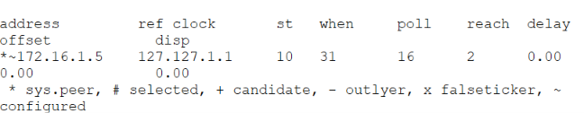

#### Floor A NTP 
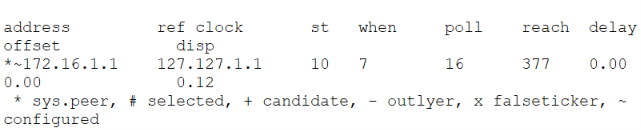

#### CS1 NTP
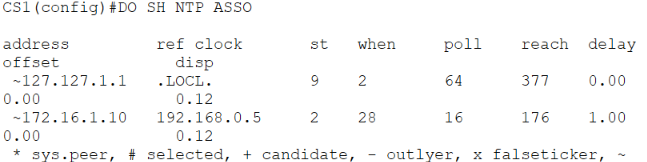

---

### FTP/TFTP Configurations 

#### FTP server configuration 
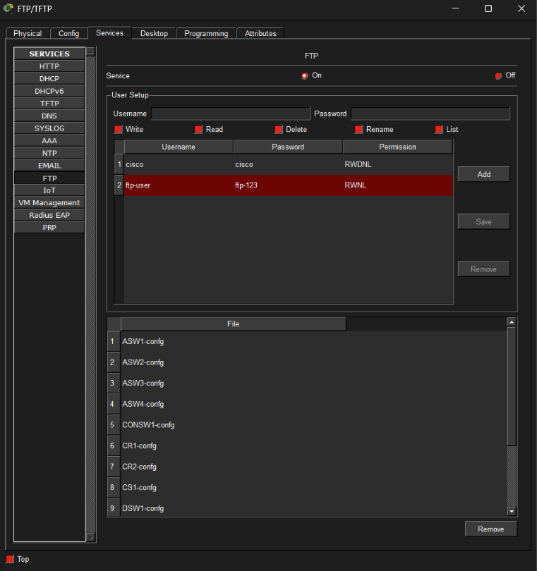

>[!NOTE]
>
>commands 
>```
>(config)# ip ftp username ftp-user
>(config)# ip ftp password ftp-123
>(config)# do write memory 
>(config)# do copy startup-config ftp:
>```
>
>The above commands have been configured on all of the network devices 

---

## Security Configurations 

### Configuring the passwords and secrets 

>[!NOTE]
>
>commands 
>```
>(config)# service password-encryption
>(config)# enable password cisco
>(config)# enable secret ccna
>(config)# username admin secret ccna 
>(config)# line console 0
>(config-line)# login local
>(config)# line vty 0 15 
>(config-line)# login local  
>```
>
>The above commands have been configured on all of the networking devices 

### Configuring the password on the ISP router 

commands 
>```
>(config)# service password-encryption
>(config)# enable password cisco
>(config)# enable secret ccna
>(config)# username verizon secret ccna 
>(config)# line console 0
>(config-line)# login local
>```
>
>The above command has been configured on the ISP 


---
### Access Control List Configurations 

#### Standard ACL configurations 

#### For SSH enabled devices 

>[!NOTE]
>This access list has been configured on all devices  to limit the SSH access to the following devices 
>- ADMIN-PC-1
>- ADMIN-PC-2
>###### Configuration 
>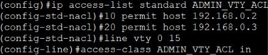

#### Extended ACL configuration 

#### ACL configuration - VLAN 10 (Sales)

>[!NOTE]
>- **Devices & Interface:** Configured extended ACL `ACL_VLAN10_IN` on `DSW1` and `DSW2`, applied inbound (`in`) on `interface Vlan10`
>- **Permitted Services:** DHCP (`bootps`), DNS (`192.168.0.8`), NTP (`192.168.0.5`), Syslog (`192.168.0.6`), SNMP (`any eq snmp`), and general traffic (`permit ip any any`)
>- **Blocked Subnets:** Management networks `192.168.100.0/24`, `192.168.200.0/24`, and `192.168.0.0/24`
>
>###### Configuration 
>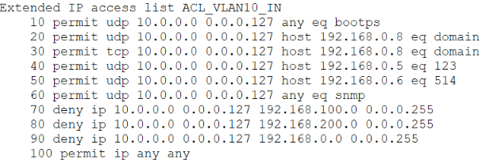

#### ACL Configuration — VLAN 20 (HR)

>[!NOTE]
>- **Devices & Interface:** Configured extended ACL `ACL_VLAN20_IN` on `DSW1` and `DSW2`, applied inbound (`in`) on `interface Vlan20`
>- **Source Subnet:** HR subnet `10.0.0.128/25` (`10.0.0.128 0.0.0.127`)
>- **Permitted Services:** DHCP (`bootps`), DNS (`192.168.0.8`), NTP (`192.168.0.5`), Syslog (`192.168.0.6`), SNMP (`any eq snmp`), and general traffic (`permit ip any any`)
>- **Blocked Subnets:** Management networks `192.168.100.0/24`, `192.168.200.0/24`, and `192.168.0.0/24`
>
>###### configuration 
>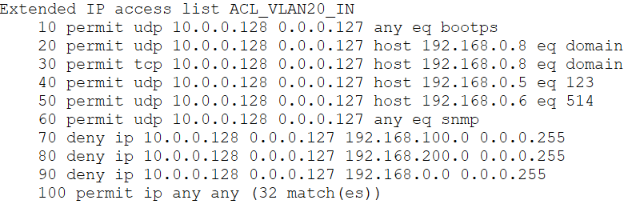

#### ACL Configuration — VLAN 40 (Dev)

>[!NOTE]
>- **Devices & Interface:** Configured extended ACL `ACL_VLAN40_IN` on `DSW3` and `DSW4`, applied inbound (`in`) on `interface Vlan40`
>- **Source Subnet:** Dev subnet `10.1.0.0/25` (`10.1.0.0 0.0.0.127`)
>- **Permitted Services:** DHCP (`bootps`), DNS (`192.168.0.8`), NTP (`192.168.0.5`), Syslog (`192.168.0.6`), SNMP (`any eq snmp`), and general traffic (`permit ip any any`)
>- **Blocked Subnets:** Management networks `192.168.100.0/24`, `192.168.200.0/24`, and `192.168.0.0/24`
>
>###### configuration
>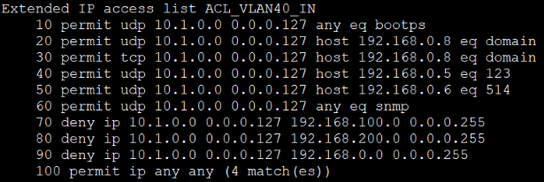

#### ACL Configuration — VLAN 50 (QA)

>[!note]
>- **Devices & Interface:** Configured extended ACL `ACL_VLAN50_IN` on `DSW3` and `DSW4`, applied inbound (`in`) on `interface Vlan50`
>- **Source Subnet:** QA subnet `10.1.0.128/25` (`10.1.0.128 0.0.0.127`)
>- **Permitted Services:** DHCP (`bootps`), DNS (`192.168.0.8`), NTP (`192.168.0.5`), Syslog (`192.168.0.6`), SNMP (`any eq snmp`), and general traffic (`permit ip any any`)
>- **Blocked Subnets:** Management networks `192.168.100.0/24`, `192.168.200.0/24`, and `192.168.0.0/24`
>
>###### configurations
>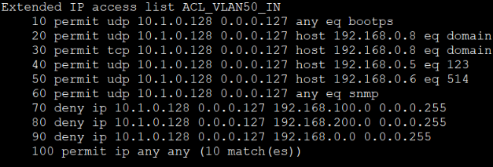

---
### Configuring the IP NAT translations 

>[!NOTE]
>- The configurations has been performed on the CS1 device 

>[!WARNING]
>- Initially this failed due to packet tracers limitations of the multilayered switch not being able to support the **no switchport command**
>
>**The Fix**
>- This was to simply add another router **CE (Customer Edge Router) to the network** 

>[!NOTE]
>The following commands were performed on CER
>
>commands
> 
>```
>CER(config-router)#int G0/1/0
>CER(config-if)#ip nat inside
>CER(config-if)#int G0/0
>CER(config-if)#ip nat outside
>```
>
>NAT ACL configured on CER is given below 
>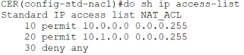
>
>To apply the NAT to the outside interface the following command has been configured
> 
>NAT configuration type : PAT (Port Address translation)
>
>command 
>```
>CER(config)#ip nat inside source list NAT_ACL interface G0/0 overload
>```
